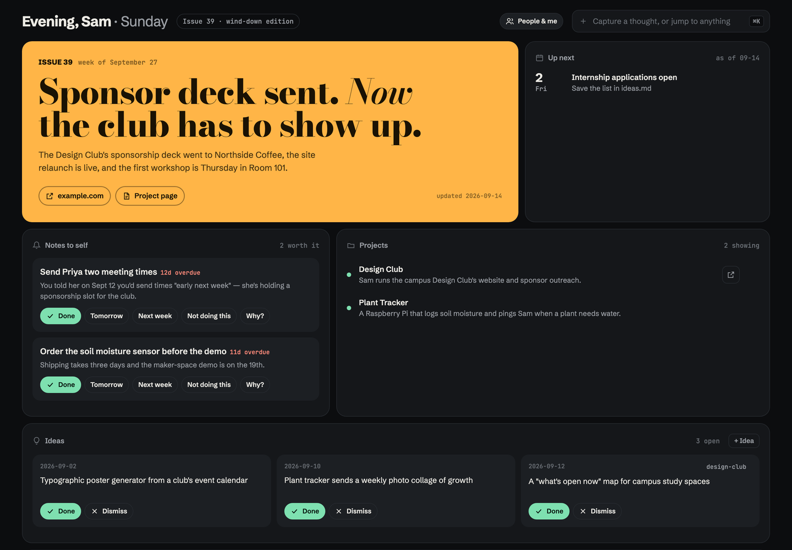
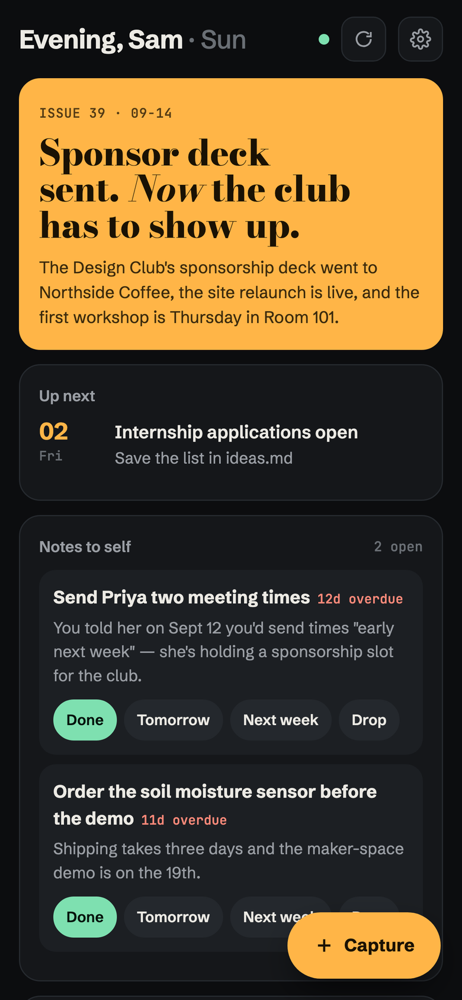

# brain

[](https://github.com/7shep/newbrain/actions/workflows/tests.yml)

Alex's fork of [zacfink/brain](https://github.com/zacfink/brain), with Claude Code hooks, calendar context, automatic session notes, and local math rendering.

A personal "digital brain" for working with Claude Code: a folder of plain
markdown notes that Claude reads instead of re-deriving context every session, plus a small local app to browse and
act on them.



- **Cover story:** Claude writes a magazine-style headline about your week after real work.
- **Study sessions:** Start/Stop controls, a live timer, timestamped history, interruption recovery, and a Tutor Genome with evidence and retraction. Windows attempts Discord DND using desktop accessibility controls. Run `/study` in Claude Code for guided tutoring and automatic evidence recording; see [the study session guide](docs/study.md). Phone shows synced history read-only.
- **Daily tasks:** a small checklist for everyday tasks: add, check off, or remove items. Starts empty at local midnight; past lists stay in dated Markdown notes. Available on desktop and phone (phone changes use the existing sync queue).
- **Notes to self:** reminders Claude adds only when they help. You can mark them Done (with confetti), snooze them, or say "Not doing this", which retires them for good.
- **Projects:** hide the ones you're not working on; they wait under "Show hidden".
- **How Claude adapts to you:** habits Claude follows every session. Claude can *propose* a new one, and you switch each on or off. You can also brainstorm a habit in the app, and Claude talks it through with you next session. Past habits stay out of the way.
- **⌘K capture:** type a thought, idea, to-do or person. Claude files it into the right note next session.
- **Ideas board:** mark ideas done or dismiss them.
- **Edit in place:** every note, person and project page opens in a side panel with a live markdown preview. ⌘S saves the file.
- **Reopen anything:** copy the command to resume a past Claude chat, open a project in VS Code, or open its live site.
- **Map of everything:** if you've run graphify on your notes (`graphify-out/graph.json`), a Map tile draws the knowledge graph in the app's colours. Hover a dot to see its links, click to open its note, use the legend to focus one cluster, or search it: type a few letters and it suggests matching ideas and clusters, then flies to the one you pick.
- **Themes:** five families, each with its own modes: Classic and Brain (Light, Soft light, Dark, Soft dark, or Auto to follow your system), plus three unique ones, Phosphor, Riso and Swiss. Pick one in **Settings** on either device; with **Sync theme** on (the default, a switch on each) the other follows (shared through `claude/theme.json`), and off each keeps its own.
- **Everything we've done:** one self-contained note per session, in a full-width timeline.
- **People & me:** your profile and contacts, in the People tile on the board.
- **On your phone:** a home-screen app with the cover, Up next, Notes to self, projects, ideas, habits and capture. It works with your laptop off, using a private GitHub repo as the backend. [Set it up →](#on-your-phone)
- **Background agents:** anything you capture can start a headless Claude Code agent that files it or does it. [More →](#background-agents-optional)
- **Stats:** prompts sent, sessions, subagents, tool calls, tokens and storage, with 30-day charts, read straight from Claude Code's transcripts (`~/.claude/projects`).
- **How well Claude knows you:** Claude logs each bet it makes about what you'll want (a recommended option, a guess, a draft), and Brain scores its calibration.
- **Routines:** your Claude Code routines (scheduled cloud agents) with their schedule and last run; run, pause or resume one from the Mac, see which look unnecessary, and pick from suggested new ones in Capture (Routine). The phone shows them read-only.

Everything is plain markdown on your machine. The app is a few small Python files plus one HTML file, uses only the
standard library, has no build step, and runs on macOS, Windows and Linux.


## Upstream usage example (Zac, not Alex)

I've run every Claude Code session through this since May 2026: 49 sessions across 13 projects, with 15 habits Claude
follows on every session. A few things it has shipped:

- **[qweb.dev](https://qweb.dev)**, the 2026 site for Queen's Web Development Club, which I co-chair: rebuilt in
  React + Supabase and shipped through PRs.
- **[zacfinkelstein.ca](https://zacfinkelstein.ca)**, my portfolio.
- The weekly admin of a full course load: syllabi into my calendar, lab prep, reminders.

The habits are the part I'd copy. Each one exists because something went wrong once. For example, I brought Claude a
popular "LLM council" skill (11 subagents per question). It argued me out of it: same model, fake independence, and
10–20× the tokens for an answer I can get by asking. That argument became a habit: **when I pitch a project, Claude
argues against it first.**

### My setup

**The 16 habits Claude follows every session** (from `claude/habits.md`; each started as something that went wrong once):

| How we talk | How Claude works | What Claude never does |
|---|---|---|
| Lead with the answer, keep it short | Read the brain first, write it back after | Invent facts about my club; real content only |
| Pitch one practical thing, then move far | Check my notes before trawling email and calendar | Relitigate a decision I've already made |
| Argue against a new project idea before building it | Open a task list when work has 3+ steps | Reach me through the terminal (it's the calendar; my laptop stays home) |
| Let me pick more than one answer | Check both calendars before proposing times | Trust a branch other than `main` on the club site |
| Interested, not eager, in outreach | Open finished files for me, and commit + push notes after updating them | Treat an iCloud-synced Desktop like a normal folder |

**Skills I wrote:**
- [`/wild`](.claude/skills/wild/SKILL.md): the one exception to "argue first". When I say "go wild", Claude generates 40+ ideas across 8
  forced angles (absurd scale, wrong medium, flip the user, collide my projects, cog sci, startup-in-10-days,
  anti-idea, pure bit), pushes the 5 strangest further, then lands on exactly two: one doable this month and one pure
  fun. Tested against a no-skill baseline: 12 sensible ideas became 45 across every angle, 7 of them physical.
  **Make your own:** paste this into Claude Code and it builds a `/wild` around your projects, your field and your
  constraints, then test-runs it on one of your projects:

  ```text
  Make me a personal /wild skill for Claude Code: a mode I trigger by saying "go wild" that floods me with over-the-top ideas, then lands on the two worth doing.

  Use https://github.com/zacfink/brain/blob/main/skills/wild/SKILL.md as the template. Keep its shape exactly: the flood (40+ one-line ideas under forced lenses, at least 4 per lens), mutate (push the 5 strangest one level further), land it (exactly two picks: "wild but doable this month" with a first step, and "pure fun"), then stop. Keep its common-mistakes table.

  Personalize it to me:
  1. First look for context about me: a CLAUDE.md, a notes folder (like ~/Notes/INDEX.md), my repos. Then ask me at most 3 short questions to fill gaps: my projects, what I study or work on, and my real constraints (time, money, gear, where I usually am).
  2. Rewrite the "Collide projects" lens with my actual projects, and the "Cog sci mode" lens as the deep field I care about (swap it for mine, e.g. economics, biology, music).
  3. Replace one lens with one invented for me. For a designer that might be "make it ugly on purpose"; for a founder, "sell it to your harshest customer".
  4. Rewrite the Grounding section to point at wherever my context actually lives.
  5. Update the description's trigger phrases to include how I'd naturally ask.

  Save it to ~/.claude/skills/wild/SKILL.md. Then test it: run it once on one of my real projects and show me the result, so I can see it works before I rely on it.
  ```

The tailored skill in this fork lives in `.claude/skills/wild/SKILL.md`, a real directory tracked in Git so Windows does not need symlink support. Open Claude Code in this repository and run `/wild` or say "go wild". Start a fresh Claude Code session after pulling if it is missing from the skill list. The home-directory installation in the prompt above is optional for use outside this repository and must be installed separately on each computer.

**What I build on:** [Superpowers](https://github.com/obra/superpowers) (brainstorm, then spec, then plan, then
test-first for anything real), [graphify](https://github.com/safishamsi/graphify) (the Map), and the impeccable
design plugin for UI work. Brain is the glue: it's where the habits, the specs and every session's outcome live.

## Start from scratch (one prompt)

New to Brain? Paste this into [Claude Code](https://claude.com/claude-code) and answer its questions. It does every
step below for you and ends by giving you a link to open on your phone.

```text
Set up Brain (https://github.com/7shep/newbrain) for me from scratch. Work through it step by step, tell me what
each step is for in one line, and ask me before anything that touches my accounts.

1. Clone https://github.com/7shep/newbrain.git into ~/Notes/.brain (keep anything already in ~/Notes), link
   ~/Notes/.brain/bin/brain into ~/.local/bin (create it, and add it to my shell profile's PATH if it isn't
   there), and read ~/Notes/.brain/README.md and FORMATS.md before going on.
2. Interview me briefly: my name, what I do, my active projects, people I work with, anything due in the next two
   weeks. Then write my first notes in the FORMATS.md shapes: me.md, now.md, one page per project, people pages,
   nudges.md, ideas.md, inbox.md and claude/habits.md (two or three habits from what I told you, status "proposed").
   If you can see my projects folder, calendar or email, use them to fill gaps, and say what you took from where.
3. Connect yourself: follow Connect Claude Code below, merging into ~/.claude/settings.json and my CLAUDE.md
   (don't overwrite existing hooks or instructions). Then run python3 ~/Notes/.brain/build.py.
4. Start the app with `brain` and check it opens at http://127.0.0.1:4747.
5. Phone (ask me first): add ".brain/" to ~/Notes/.gitignore, create a PRIVATE GitHub repo "notes" with gh,
   add docs/notes-workflow.yml as .github/workflows/brain.yml plus phone/queue/.gitkeep, commit and push, and wait
   for the Action's first run to write phone/state.json.
6. Walk me through making the phone key (README → On your phone, step 3); I paste it to you. Then give me my
   one-tap install link: https://7shep.github.io/newbrain/mobile/#c= followed by base64 of
   {"repo":"<me>/notes","token":"<key>"}. Tell me to open it in Safari, tap Share → Add to Home Screen, and treat
   the link like a password. Don't save the key anywhere.
7. Finish with a short list: what's set up, what I should try first, and anything that didn't work.
```

## Try it (30 seconds)

```bash
git clone https://github.com/zacfink/brain.git
cd brain
python3 app/server.py --notes example      # opens http://127.0.0.1:4747  (Windows: py app\server.py --notes example)
```

`example/` is a fictional student's notes. Requires Python 3.9+ and nothing else.

## Use it for real

The brain folder lives *inside* your notes folder as `.brain/`, so the app finds your notes as its parent:

```bash
mkdir -p ~/Notes && git clone https://github.com/zacfink/brain.git ~/Notes/.brain
ln -s ~/Notes/.brain/bin/brain ~/.local/bin/brain    # any folder on your PATH
brain                                                # start + open;  brain stop / restart / log
```

**Windows:** clone into `%USERPROFILE%\Notes\.brain` and run `%USERPROFILE%\Notes\.brain\bin\brain.cmd` (or add
`bin` to your PATH and run `brain`). It opens your browser; close the window to stop it.

Start your notes from the shapes in [`FORMATS.md`](FORMATS.md). You can also copy `example/` and edit it, or just ask
Claude Code to draft them from your projects, calendar and email. `BRAIN_NOTES=/some/folder brain` points the app
somewhere else.

### Connect Claude Code

1. **Hooks** in `~/.claude/settings.json` (merge with what's there). Use your Brain checkout's real path:
   ```json
   "hooks": {
     "SessionStart": [{ "matcher": "startup|resume", "hooks": [{ "type": "command", "command": "python3 /path/to/newbrain/brain_session_hook.py", "timeout": 30 }] }],
     "Stop": [{ "hooks": [{ "type": "command", "command": "python3 /path/to/newbrain/brain_save_session.py", "timeout": 10 }] }],
     "SessionEnd": [{ "hooks": [{ "type": "command", "command": "python3 /path/to/newbrain/brain_save_session.py", "timeout": 3 }] }]
   },
   "permissions": { "additionalDirectories": ["/path/to/newbrain/personal-notes"] }
   ```
   The start hook refreshes `now.md` from your calendar feeds when configured, rebuilds `INDEX.md`, and gives Claude
   your active habits, the inbox and the morning-update reminder. It makes no model call. The save hooks write or
   update a transcript-based note in `sessions/` after each completed turn and again when the session ends. That note
   records requests and final responses; it can't infer every decision or file change, so authored session notes
   remain useful for significant work. `additionalDirectories` lets sessions started in other project folders file
   captures and update notes. The hooks use `personal-notes/` inside the checkout, or `$BRAIN_NOTES` when set.
2. **Instructions** in your `~/.claude/CLAUDE.md`, for example:
   > My notes folder is my brain. Before project work, read its `INDEX.md` and the project page. File any inbox
   > captures into the right note. Follow `on` habits in `claude/habits.md`, and propose (never enable) new ones.
   > Add nudges to `nudges.md` only when they clearly help me, and never re-add one marked `no`. After real work,
   > update the session note (`session-template.md`), the project page and `now.md`, then run `build.py`.

**Personal Windows daily setup:** keep private notes in `personal-notes/` (ignored by Git) and run
`powershell -ExecutionPolicy Bypass -File bin/install-daily.ps1` from this repo. It adds the hooks and the notes
directory above to `%USERPROFILE%\.claude\settings.json` (using `py`) and a Windows Startup shortcut. At sign-in,
Brain opens in the browser alongside an interactive Claude Code terminal. Run `bin/brain-daily.ps1` to start the
same pair immediately.

For calendar updates, put `{"urls":["<secret iCal address>"]}` in `personal-notes/calendar_sources.json`. Use the
**Secret address in iCal format** from Google Calendar settings. This file stays local and is not tracked by Git.
The importer reads upcoming events only; it never changes your calendar. Add a second secret address to include a
second calendar. Google Calendar remains the source of truth.

**Background agents:** install Claude Code and log in once (`claude`), since a background agent can't answer a
login prompt. Create `personal-notes/agents/` to opt in. See [Background agents](#background-agents-optional).

## How it fits together

```
~/Notes/                      your notes (keep private)
├── INDEX.md                  generated table of contents — Claude reads this first
├── me.md  now.md  nudges.md  ideas.md  inbox.md
├── claude/habits.md
├── projects/<slug>.md        current truth per project
├── people/<slug>.md
├── sessions/YYYY-MM-DD-*.md  one note per Claude Code session (history)
├── agents/                   optional: turns on background agents; one log file per run
├── phone/                    optional: turns on the phone app (queue/ + state.json)
└── .brain/                   this repo
    ├── app/server.py         stdlib HTTP server: reads/writes the notes, serves the app
    ├── app/index.html        the whole UI (vanilla JS, no build)
    ├── app/theme.css         colours and light/dark themes, shared with the phone app
    ├── app/agents.py         background agent runner (queue, one at a time, status files)
    ├── app/sync.py           git pull/commit/push for the phone app
    ├── app/phone.py          applies phone actions on GitHub, writes phone/state.json
    ├── mobile/               the phone app (served from GitHub Pages)
    ├── build.py              regenerates INDEX.md
    ├── session_start.py      the Brain context every session starts with
    ├── brain_session_hook.py Claude Code SessionStart hook: calendar, INDEX.md, then that context
    ├── brain_save_session.py Claude Code Stop/SessionEnd hook: writes the session note
    ├── bin/brain, brain.cmd  launchers (macOS/Linux, Windows)
    ├── FORMATS.md            file shapes the app parses
    ├── example/              fictional notes to try it with
    └── tests/                unit tests, run on every push by GitHub Actions
```

**Why markdown files instead of a database?** Claude reads and edits them with the tools it already has. Opening
a file costs nothing until it's needed, and you stay in control of your own data.

## Background agents (optional)

Create an `agents/` folder in your notes and anything you capture in the app (a note, idea, todo, person or habit
proposal) also starts a headless Claude Code agent (`claude -p`). It files the thought where it belongs, or does the
task, writes a short report and exits. Runs go one at a time with a 20-minute limit, and a small "agents" chip in the
top bar turns amber while one is working. Click it for the reports.

The agent's permissions are an allowlist, not a denylist. It runs with `--setting-sources project --permission-mode
dontAsk`, so your own Claude settings can't widen it and anything off the list is refused. It can read, edit notes and
project files, search the web, create Gmail drafts and add calendar events. It can't send email or texts, commit,
push or run arbitrary shell commands. Outward actions come back as drafts for you to send. A Routine capture sets up a
Claude Code routine, created paused, with RemoteTrigger as its only tool.

Each run writes `agents/<time>-<slug>.md` (queued, running, then done or failed), so the state survives a restart. The
runner's tests use a fake `claude`, so they're free: `python3 -m unittest discover -s tests`.

## On your phone



A home-screen app for the parts you use on the go: the cover story, Up next, Notes to self (Done / Tomorrow / Next
week / Drop), projects (tap to read), ideas, Claude's habits and **Capture**. It works with your laptop closed.

**How:** your notes live in a private GitHub repo, and that repo is the backend. The phone never edits a note
itself. Each tap drops a tiny file into `phone/queue/`, and a GitHub Action applies it with the same Python code the
desktop app uses (so the two can't disagree), then rebuilds `phone/state.json`, the summary the phone reads. That
takes about 30 seconds, and the phone shows your change straight away in the meantime. A capture from your phone
gets its background agent the next time your laptop pulls.

On your laptop, Brain pulls from GitHub when it starts, when you reload the page and when a Claude session starts.
It commits and pushes only the notes it changed itself. If the phone and laptop ever change the same note in a way
git can't combine, it stops and says "Sync paused" instead of guessing.

**Set it up (about 10 minutes):**

1. **Put your notes in a private GitHub repo** (`~/Notes` with `.brain/` in its `.gitignore`) and push it.
2. **Add the Action:** copy [`docs/notes-workflow.yml`](docs/notes-workflow.yml) to `.github/workflows/brain.yml`
   in the notes repo, create `phone/queue/.gitkeep`, then commit and push. Its first run creates `phone/state.json`.
3. **Make a key for your phone:** github.com → your avatar → **Settings → Developer settings → Personal access
   tokens → Fine-grained tokens → Generate new token**.
   - **Repository access:** *Only select repositories* → your notes repo.
   - **Permissions:** the page lists every permission a key could have, which is normal. Under **Repository
     permissions**, set **Contents** to **Read and write**. Leave everything else at *No access*. GitHub sets
     *Metadata* to read-only on its own. (Newer GitHub shows an **Add permissions** button instead: add *Contents*,
     then choose *Read and write*.)
   - The summary should read "Read access to metadata" and "Read and Write access to code". Generate it and copy
     the `github_pat_…` key.
4. **Install the app:** on your phone, open the `mobile/` URL from your fork's GitHub Pages deployment in Safari (or Chrome on
   Android) → Share → **Add to Home Screen**. Open it, tap **Connect**, enter `your-name/notes` and paste the key.

The key stays on your phone only. The app's code is public and holds no notes. You can revoke the key on GitHub
anytime.
<br clear="right">

### Phone voice questions

Hold the mic, speak, and release to ask your notes a question; supported browsers read the answer aloud.
The queue still goes through the private notes repo. Only `INDEX.md`, `now.md`, and project Markdown pages are
supplied as question context, and the model gets no tools.

Each question goes to the lightest model that can handle it. A quick Haiku call sorts the queued questions first:

| Tier | Model | For |
|---|---|---|
| everyday | Claude Haiku 5.5 | looking things up in your notes, reminders, "remember…", schedules, quick advice |
| coding | Claude Sonnet 5.5 | straightforward programming questions |
| intense | Claude Opus 5.5 | multi-step planning, hard reasoning, difficult code |

Questions in the same tier share one call, and a question the sorter misses goes to Sonnet. The tiers and their
models live in `TIERS` at the top of `app/phone.py`.

Answers run on your Claude plan, not an API key: each call is a headless `claude -p` with no tools, so it counts
toward your plan's usage like any Claude Code session. To enable them while your laptop is off, run
`claude setup-token` once, then add the token it prints as a `CLAUDE_CODE_OAUTH_TOKEN` repository secret in the
private notes repo and copy the updated [workflow template](docs/notes-workflow.yml) there. The workflow checks out
`7shep/newbrain`, prepares the questions, installs Claude Code and answers them in a step that is the only one to see
the secret, then applies answers and ordinary phone actions through Python. With no secret or an invalid answer, the
question fails visibly while other queued actions continue. Normal captures and reminders need no secret. A local
queue run (`python3 app/phone.py personal-notes`) uses your existing Claude Code login.

### Internships and morning context

Rows in `internships/tracker.md` appear in the desktop Internships tile, grouped by status. The three
themes work on desktop and phone. Up next reads only the `## Upcoming` section of `now.md`, sorted by
date and time. Session context reminds Claude when today's `## Today · YYYY-MM-DD` section is missing,
using the configured notes folder and available calendar data without delaying your current request.

## Security

The server binds to `127.0.0.1` only. Every API call needs a random per-run token embedded in the page, and requests
whose `Host` isn't local are rejected, which blocks DNS rebinding. Reads and writes are limited to `.md` files inside
the notes folder, never dot-folders. Saves detect edits made on disk since you opened a file, so you won't
overwrite Claude's changes.

Your notes folder will likely hold contacts and personal details. Keep it out of public repos, and keep the notes
repo private if you use the phone app. The phone's key can reach only that one repo.

## Notes

The tests run on macOS, Windows and Linux on every push. The app is used daily on macOS with Chrome and Safari. Fonts load from Google Fonts, with system fallbacks when offline. Resume
buttons read session ids from `~/.claude/projects` and copy a `claude --resume` command.

## License

[MIT](LICENSE)

### Math in notes

Notes and editor previews typeset LaTeX using bundled KaTeX 0.16.22, including local fonts. Use `$x^2$` or `\(x^2\)` for inline math, and `$$...$$` or `\[...\]` for display equations. Display expressions can span multiple lines and include environments such as `aligned`, `pmatrix`, and `cases`. Code spans and fenced code blocks show their source literally. Unsupported TeX appears in red without interrupting the note.

Run the math regression checks with `node tests/test_math.cjs`; run the Python suite with `py -m unittest discover -s tests`.

### Routines

Brain can't call the routines API itself: it needs the login only Claude Code holds. So it runs headless `claude`
with nothing allowed but the RemoteTrigger tool, asks for compact JSON, and caches the answer in
`claude/routines.json` (when the app opens and the copy is over 10 minutes old). The desktop tile can run, pause and
resume a routine; the phone reads the same snapshot. Suggestions for new routines come from a once-a-day pass over
your notes. See `app/routines.py`.

### Automatic daily checklists

Add `claude/day-planner.md` to your private notes to enable the planner described in
[FORMATS.md](FORMATS.md). A fresh daily list contains schoolwork based on upcoming
tests and deadlines, weekly gym visits, and laundry, without assigning time slots.
Change the note's course overrides when a class needs more or less preparation.
Existing daily lists stay intact; new rules apply to the next fresh list.

The private notes workflow already runs daily at 09:00 UTC (4am Toronto in winter,
5am in summer), even with the laptop off. It generates the daily checklist and phone
state. Desktop also generates a missing list when opened. GitHub may delay scheduled
runs. No AI subscription or background-agent permission change is needed.

For unattended deadline refresh, add a **private notes repository Actions secret**
called `BRAIN_CALENDAR_SOURCES`, containing `{"urls":["<Google secret iCal URL>"]}`.
Include every calendar whose deadlines should inform the plan. The updated workflow
refreshes `now.md` before generating the list; no calendar events are changed.
Local refresh still supports the ignored `calendar_sources.json` file. With neither
source configured, the planner uses saved upcoming dates and visibly flags a calendar
that has not refreshed today. Never commit the source URLs. A same-day checklist is
not rebuilt automatically after calendar or preference changes, preserving your edits.
